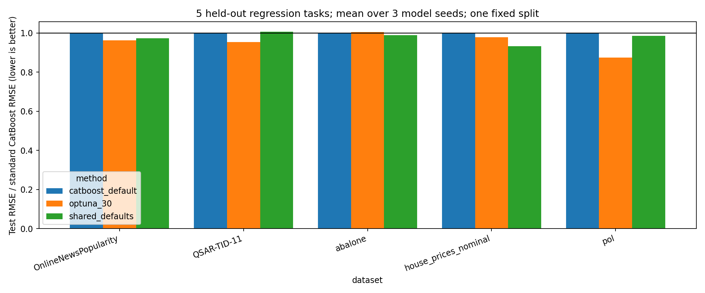

# CatBoost defaults across regression datasets

Can one CatBoost configuration selected on several datasets transfer to new ones? I tested this on ten development and five held-out OpenML regression tasks. The shared configuration reduced the geometric mean of test RMSE ratios by **2.34%** relative to standard CatBoost. It improved four of five tasks. Dataset-specific Optuna tuning achieved **4.63%**, at the cost of a new search for each dataset.

I was motivated by Holzmüller, Grinsztajn and Steinwart, [*Better by default: Strong pre-tuned MLPs and boosted trees on tabular data* (NeurIPS 2024)](https://proceedings.neurips.cc/paper_files/paper/2024/hash/2ee1c87245956e3eaa71aaba5f5753eb-Abstract-Conference.html). Their idea of selecting strong defaults across tasks prompted this independent CatBoost study. I chose the datasets, search space, split procedure, metrics and implementation. This is not a reproduction of their complete benchmark or published scores.

## Protocol

```text
10 development tasks → 30 global Optuna trials, each evaluated on all 10 validation sets
                     → freeze one shared CatBoost configuration
 5 held-out tasks    → 30 local Optuna trials per task
                     → freeze all choices → test 3 methods × 3 seeds
```

The three methods are the library default under the common training protocol, one shared configuration, and a separate 30-trial Optuna search for each held-out task. The common protocol fixes GPU execution, RMSE loss, model seeds and target standardization. “Default” here does not mean an entirely untouched constructor.

Each dataset is fetched by immutable OpenML data ID and checked against its target metadata. Preparation removes missing targets and exact duplicate rows, caps datasets at 30,000 rows deterministically, and drops columns constant in the training split. Identical feature vectors are grouped before a deterministic 60/20/20 train/validation/test split, preventing the same predictors from crossing splits. Target mean and standard deviation come from training rows only. CatBoost handles categorical columns and missing numeric values. Some targets are discrete or ordinal; I deliberately model them as regression with squared-error loss. These custom splits differ from OpenML leaderboard splits.

For global selection, I divide validation RMSE by the RMSE of a training-mean predictor on the same validation set and average the logarithms of these ten ratios. This gives tasks with different target scales comparable influence. Local searches optimize the corresponding single-task validation ratio. The model fits training rows only, with a fixed number of iterations and no early stopping. Parameter choices were locked before calculating test metrics. The three final seeds (42, 137, 2026) use the **same data split**, so they capture training variation, not split uncertainty.

| Role | OpenML ID | Dataset | Target | Rows | Features | Categorical |
| --- | ---: | --- | --- | ---: | ---: | ---: |
| Development | [216](https://www.openml.org/d/216) | elevators | Goal | 16,599 | 17 | 0 |
| Development | [287](https://www.openml.org/d/287) | wine_quality | quality | 5,318 | 11 | 0 |
| Development | [507](https://www.openml.org/d/507) | space_ga | ln(VOTES/POP) | 3,107 | 6 | 0 |
| Development | [541](https://www.openml.org/d/541) | socmob | counts_for_sons_current_occupation | 1,156 | 5 | 4 |
| Development | [546](https://www.openml.org/d/546) | sensory | Score | 576 | 11 | 11 |
| Development | [550](https://www.openml.org/d/550) | quake | col_4 | 2,177 | 3 | 0 |
| Development | [42225](https://www.openml.org/d/42225) | diamonds | price | 30,000 | 9 | 3 |
| Development | [42570](https://www.openml.org/d/42570) | Mercedes_Benz_Greener_Manufacturing | y | 4,208 | 353 | 8 |
| Development | [42571](https://www.openml.org/d/42571) | Allstate_Claims_Severity | loss | 30,000 | 129 | 115 |
| Development | [42730](https://www.openml.org/d/42730) | us_crime | ViolentCrimesPerPop | 1,994 | 126 | 0 |
| Held out | [201](https://www.openml.org/d/201) | pol | foo | 14,958 | 26 | 0 |
| Held out | [3050](https://www.openml.org/d/3050) | QSAR-TID-11 | MEDIAN_PXC50 | 5,626 | 1,024 | 0 |
| Held out | [42563](https://www.openml.org/d/42563) | house_prices_nominal | SalePrice | 1,460 | 79 | 43 |
| Held out | [42724](https://www.openml.org/d/42724) | OnlineNewsPopularity | shares | 30,000 | 59 | 0 |
| Held out | [42726](https://www.openml.org/d/42726) | abalone | Class_number_of_rings | 4,177 | 8 | 1 |

The Optuna search space covers 500/1,000/2,000 trees, depth 4–8, log-uniform learning rate 0.01–0.20, log-uniform L2 regularization 1–50, 32/64/128 borders, one-hot threshold 2/10/25, and Bayesian (temperature 0–5) or Bernoulli (subsample 0.6–1) bootstrap. Global trial **0** remained best after all 30 trials. Its configuration was `iterations=2000`, `depth=7`, `learning_rate=0.0234511`, `l2_leaf_reg=1.43579`, `border_count=128`, `bootstrap_type=Bayesian`, `one_hot_max_size=25`, `bagging_temperature=2.35121`. This observation does not imply that a single trial is normally sufficient.

## Results

Test RMSE values are means across three seeds. Percentages are changes against the default mean on the same dataset; negative is better.

| Dataset | Default RMSE | Shared RMSE | Shared change | Local Optuna RMSE | Optuna change |
| --- | ---: | ---: | ---: | ---: | ---: |
| OnlineNewsPopularity | 8,238.06 | 8,014.73 | −2.71% | **7,933.56** | **−3.70%** |
| QSAR-TID-11 | 0.88435 | 0.88997 | +0.64% | **0.84324** | **−4.65%** |
| abalone | 2.16513 | **2.13938** | **−1.19%** | 2.17534 | +0.47% |
| house_prices_nominal | 26,500.20 | **24,703.77** | **−6.78%** | 25,942.64 | −2.10% |
| pol | 6.00699 | 5.91836 | −1.48% | **5.24665** | **−12.66%** |
| **Geometric mean ratio** | **1.0000** | **0.9766** | **−2.34%** | **0.9537** | **−4.63%** |



Raw RMSE cannot be averaged across different target units. I take each task's mean RMSE relative to the default, then the geometric mean across tasks. The [test summary](results/gpu-2026/test_summary.csv), [ratios](results/gpu-2026/rmse_ratios_vs_default.csv), [aggregate](results/gpu-2026/descriptive_aggregate.csv) and [search costs](results/gpu-2026/search_costs.csv) are compact exports from the run. I independently recalculated RMSE, MAE and R² from all 45 saved prediction files; they matched the exported metrics. The prediction files include test labels and are not published.

Five held-out datasets give limited evidence for general transfer. An exploratory exact one-sided Wilcoxon test of the five task ratios yields `p=0.0625` for both shared and locally tuned configurations against default, above the usual 0.05 threshold. These tasks have now been inspected and cannot be reused as untouched test tasks after changing the method.

The methods do not have equal training budgets. Default uses 1,000 trees, shared uses 2,000, and Optuna chooses among 500/1,000/2,000. Extra trees may explain some improvement. Average final fit time across tasks was 16.8 seconds for default, 26.0 for shared, and 21.8 for the selected local models. Global selection cost 300 search fits; local tuning cost 30 per held-out task. Once selected, shared defaults require no new search on a new task. Timings are specific to the Kaggle GPU environment.

## Reproduction

[kaggle_experiment.py](kaggle_experiment.py) contains the executed GPU pipeline, including dependency installation, dataset IDs, checkpointing and result export. In a Kaggle Python notebook, enable **GPU T4 x2** and **Internet**, paste the entire file into one cell, then select **Save Version → Save & Run All**. Outputs appear in `/kaggle/working/catboost_defaults_lab/archives/`. Download `analysis_results.zip` to inspect the completed analysis and `resume_checkpoint.zip` to resume a paused run. On a later session, attach the previous notebook output as an input; the code can detect its checkpoint. Do not use the analysis archive as a resume checkpoint. Full training requires a working CatBoost GPU and OpenML network access; it intentionally does not fall back to CPU.

Data, model files, checkpoints, prediction arrays and the Optuna database are excluded from Git. Consult the OpenML pages for individual dataset terms. Project code is MIT licensed; paper and data have separate terms.

A useful follow-up is to freeze the method and evaluate it on new, untouched regression tasks, ideally with multiple splits and equal training budgets.
