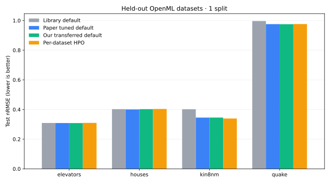

# Better CatBoost defaults: a small transfer study

**Portfolio project · tabular regression · CatBoost · reproducible benchmarking**

This project tests an idea from Holzmüller, Grinsztajn and Steinwart's NeurIPS 2024 paper [*Better by Default: Strong Pre-Tuned MLPs and Boosted Trees on Tabular Data*](https://proceedings.neurips.cc/paper_files/paper/2024/file/2ee1c87245956e3eaa71aaba5f5753eb-Paper-Conference.pdf): can one fixed CatBoost configuration, selected on several datasets, transfer to new datasets without tuning each one from scratch?

This is an **independent, small-scale partial reproduction** of the CatBoost regression idea. It is not a reproduction of the paper's full 208-dataset benchmark, its 10 splits, or its RealMLP contribution. The original implementation is [pytabkit](https://github.com/dholzmueller/pytabkit).

## Experiment

We compare four approaches:

1. **Library default:** `CatBoostRegressor` with CatBoost's installed-version defaults, except a shared tree budget, CPU, seed and RMSE loss.
2. **Paper tuned default:** the regression CatBoost-TD configuration in Appendix C, Table C.3 of the paper.
3. **Our transferred default:** choose one configuration from a small fixed grid using validation errors on six meta-train datasets, then apply that same configuration to four held-out datasets.
4. **Per-dataset HPO:** random hyperparameter search on each held-out dataset's validation split. This uses more fits and is a different compute budget.

Every dataset is split by fixed seed into **60% train, 20% validation, 20% test**. Hyperparameters and the number of trees are chosen with validation data only. The final model is fitted on train plus validation and evaluated once on test. The transferred configuration is selected using only the six meta-train datasets. The held-out test targets never select a configuration.

Main metric: **nRMSE = test RMSE / standard deviation of the train-plus-validation target**. This makes errors from datasets with different target units comparable. The script also reports RMSE and a shifted geometric mean of nRMSE across held-out tasks. Lower is better. The paper used a much larger benchmark and a different aggregate protocol, so these scores should not be compared numerically with its tables.

| Role | Dataset | Source ID | Target | Type |
| --- | --- | ---: | --- | --- |
| Meta-train | [Concrete Compressive Strength](https://archive.ics.uci.edu/dataset/165/concrete+compressive+strength) | 165 | Compressive strength | Regression |
| Meta-train | [Airfoil Self-Noise](https://archive.ics.uci.edu/dataset/291/airfoil+self+noise) | 291 | Sound pressure | Regression |
| Meta-train | [Wine Quality](https://archive.ics.uci.edu/dataset/186/wine+quality) | 186 | Quality score | Ordinal target treated as regression |
| Meta-train | [Abalone](https://archive.ics.uci.edu/dataset/1/abalone) | 1 | Rings | Integer target treated as regression; `Sex` is categorical |
| Meta-train | [Combined Cycle Power Plant](https://archive.ics.uci.edu/dataset/294/combined+cycle+power+plant) | UCI 294 | `PE` | Regression |
| Meta-train | [Superconductivty Data](https://archive.ics.uci.edu/dataset/464/superconductivty+data) | UCI 464 | `critical_temp` | Regression |
| Meta-test | [Elevators](https://www.openml.org/d/216) | OpenML 216 | `Goal` | Regression |
| Meta-test | [Houses](https://www.openml.org/d/537) | OpenML 537 | `median_house_value` | Regression |
| Meta-test | [Kin8nm](https://www.openml.org/d/189) | OpenML 189 | `y` | Regression |
| Meta-test | [Quake](https://www.openml.org/d/209) | OpenML 209 | `richter` | Regression |

`ucimlrepo` fetches six UCI datasets; scikit-learn fetches four OpenML datasets. Both sources are cached under `.cache/uci/`. This repository contains **no dataset copies**. Please check each source page for the dataset's license and citation when using the data elsewhere. The UCI Wine Quality API returns both red and white wine together; this project uses that combined version. Elevators, Kin8nm and Quake occur in the paper's meta-test benchmark; Houses occurs in its additional Grinsztajn benchmark. None of the four is listed in the paper's regression meta-train collection.

## Run locally

Use Python 3.10 or newer. **GPU is not required**; all runs request CPU explicitly. A normal laptop can run the quick check, while the full benchmark can take much longer.

```bash
python -m venv .venv
# Windows PowerShell:
.venv\Scripts\python -m pip install -r requirements.txt
.venv\Scripts\python run_experiment.py --smoke
.venv\Scripts\python -m unittest discover -s tests -v
```

For macOS/Linux, replace `.venv\Scripts\python` with `.venv/bin/python`. The smoke check uses only Concrete and Elevators, 50 trees and one seed. Its metrics are **not** a research conclusion.

A ten-dataset pilot:

```bash
.venv\Scripts\python run_experiment.py --iterations 300 --seeds 42 --meta-candidates 6 --hpo-trials 5 --threads 4
```

A more thorough but substantially slower run:

```bash
.venv\Scripts\python run_experiment.py --iterations 1000 --seeds 42 123 2024 --meta-candidates 12 --hpo-trials 20 --threads 4
```

The script writes `results/raw/metrics.csv`, `meta_search.csv`, `summary.csv` and `run.json`. These are ignored by Git; include only verified aggregate findings in this README. `run.json` records package versions, chosen configuration and runtime. Datasets, local caches, model files and private `.env` files are excluded by `.gitignore`.

After a completed run, create the held-out comparison chart with `.venv\Scripts\python plot_results.py`.

## Paper configuration

For regression, Table C.3 gives CatBoost-TD: Plain boosting, Bernoulli bootstrap, depth 9, learning rate 0.09, subsample 0.9, L2 leaf regularization 1e-5, random strength 0, one-hot threshold 20, leaf estimation iterations 20, 254 feature borders, 1000 trees, and early stopping `Iter`/300. The code uses CatBoost Python parameter aliases (`depth`, `iterations`, `border_count`) and reduces the stopping patience only when a shorter tree budget is requested. A 300-tree pilot therefore **does not test the exact 1000-tree paper recipe**.

## Results

**Completed pilot:** 10 datasets (6 meta-train, 4 meta-test), seed `42`, at most 300 trees, 6 candidate shared configurations, 5 HPO trials per meta-test dataset, CPU with 4 threads. Tested with Python 3.12.10, CatBoost 1.2.10, NumPy 2.4.4, pandas 3.0.3 and scikit-learn 1.5.2. These are measured results from this repository, **not** values from the paper. Lower nRMSE is better.

| Held-out dataset | Library default | Paper TD, 300 trees | Our shared default | Per-dataset HPO, 5 trials |
| --- | ---: | ---: | ---: | ---: |
| Elevators | 0.3092 | 0.3087 | **0.3084** | 0.3099 |
| Houses | 0.4025 | **0.4006** | 0.4025 | 0.4038 |
| Kin8nm | 0.4018 | 0.3455 | 0.3457 | **0.3394** |
| Quake | 0.9965 | 0.9759 | **0.9752** | 0.9762 |
| **Shifted geometric mean** | 0.4733 | 0.4528 | 0.4532 | **0.4521** |



The shared configuration selected **only on meta-train validation** was `depth=9`, `learning_rate=0.09`, `l2_leaf_reg=1`, Bernoulli bootstrap with `subsample=0.9`, `random_strength=0`, `one_hot_max_size=20`, and `border_count=254`. The other settings remain CatBoost defaults. Its one-time search cost was **36 validation fits / 202 seconds**. On the four held-out datasets, validation plus refit took about **14 seconds** for library defaults, **52 seconds** for paper TD, and **32 seconds** for our shared default. Five-trial HPO plus refit took about **104 seconds** across those datasets. Times are machine-specific and exclude data download. Global search cost is separate from the shared default's held-out fit time.

In this pilot, paper TD beat library defaults on all four held-out datasets, but the differences on Elevators and Houses were small. Our shared default was close to paper TD. Five-trial HPO had the best aggregate nRMSE by a tiny margin, while winning just one dataset. **One split and four held-out datasets cannot establish a general advantage or statistical significance.** A 300-tree cap and shortened stopping patience also mean this does **not** test the exact 1000-tree paper recipe. The HPO search space and trial count differ from the authors' 50-trial procedure.

## Limitations and next steps

- This study has only **six meta-train and four meta-test datasets**, far fewer than the paper. Dataset choice and split seed can strongly affect the outcome.
- The four meta-test datasets are held out from **our own** configuration search and from the authors' reported regression meta-train list. They do occur in the paper's evaluation benchmarks. Our data versions, preprocessing, seeds and 300-tree pilot differ, so our scores are not directly comparable with its tables.
- HPO spends many fits per held-out dataset; comparing only error hides this compute cost. `run.json` and the metrics include training times.
- All splits are random and assume rows are exchangeable. A real monthly retail turnover forecast requires a **time-based split**, store history, leakage checks and an appropriate business metric such as MAPE. The separate [RTO CatBoost project](https://github.com/y4rik2009-bit/rto-catboost-forecast) covers that context. Its competition data are not part of this repository.
- CatBoost's library defaults may change with version. `run.json` records the installed version.
- A stronger follow-up would add more independent datasets and seeds, compare confidence intervals, and test the transferred setting on a private time-series task under the dataset's usage terms.

## Author and attribution

Independent implementation by [@y4rik2009-bit](https://github.com/y4rik2009-bit). Research idea and CatBoost-TD values: [Holzmüller et al., NeurIPS 2024](https://proceedings.neurips.cc/paper_files/paper/2024/hash/2ee1c87245956e3eaa71aaba5f5753eb-Abstract-Conference.html). Dataset pages above provide source and citation information. This repository's original code is MIT licensed; that license does not apply to the paper or third-party data.

